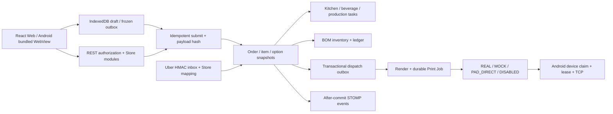

# 02 — System Architecture Audit

审计日期：2026-10-15（America/Toronto）。范围：READ-ONLY AUDIT + DOCUMENTATION + QUESTIONS。

源码基准：后端 **B = `ce35278b3569a4eacfa29efc01cadbf0c409bec6`**；线上前端 **F = `8c3a9e356f59cd025beff25f7fb1d5a20594e028`**；远端 main **M = `06bac51ddc0a829a9aa1106f07ef886572efbb65`**（本轮 `git ls-remote` 确认，未 fetch 或更新引用）。本轮证明 B/F 的 `frontend/`、`restaurant-pad-app/` 无 Git 内容差异，因此 B 中这两部分也可用于语义审查。源码链接固定到提交，不能用当前旧工作区的同名文件替代。

证据标签：`VERIFIED_IN_CODE` 表示读到固定提交中的实现；`VERIFIED_IN_PRODUCTION` 仅表示本轮明确读取的运行事实；`DOCUMENTED_ONLY` 表示仅有文档陈述；`PLANNED_ONLY` 表示计划/契约尚未证明完成；`UNKNOWN` 表示证据不足。代码被部署不等于所有行为均经过线上验证。风险优先级 P0=独立商家共享部署阻断，P1=上线前关键，P2=按首批范围处理，P3=维护改善；不代表要求立即修改现有 Production。

## 判断

可复用主体已明显超过 MVP：订单快照、幂等提交、持久化 dispatch outbox、Pad claim/lease、Organization/Store membership、Master Menu、Profile materialization、定价与 Add-on 配置均有实际代码。无需先从零重写。**多门店能力尚不能作为无关联商家的安全隔离证明**，也不能把当前默认的 St-Denis 初始化称为通用新商家模板。

生产版本/容器/迁移/入口见 [01](01_PRODUCTION_BASELINE_AUDIT.md)。下列行为除明确标注外均为 `VERIFIED_IN_CODE`，没有通过真实订单、真实账号登录、物理打印或业务表查询在 Production 重放。

## 14 个审计领域

| 领域 | 代码与边界 | 结论 / 证据 |
| --- | --- | --- |
| 1. Backend Controller / Service / Repository / Entity | Spring Boot 3.3.3 / Java 17；JPA 是主要持久化路径，另有 JdbcTemplate 和 MyBatis BaseMapper。633 份 main Java 文件；不是只含六个 MVP 模块 | [B:backend/pom.xml:43](https://github.com/Z1linXu/Restaurant_System/blob/ce35278b3569a4eacfa29efc01cadbf0c409bec6/backend/pom.xml#L43)；[B:backend/src/main/java/com/restaurant/system/menu/repository/MenuItemBomRepository.java:5](https://github.com/Z1linXu/Restaurant_System/blob/ce35278b3569a4eacfa29efc01cadbf0c409bec6/backend/src/main/java/com/restaurant/system/menu/repository/MenuItemBomRepository.java#L5)；MyBatis interceptor 仅分页 [B:backend/src/main/java/com/restaurant/system/common/config/MybatisPlusConfig.java:5](https://github.com/Z1linXu/Restaurant_System/blob/ce35278b3569a4eacfa29efc01cadbf0c409bec6/backend/src/main/java/com/restaurant/system/common/config/MybatisPlusConfig.java#L5)。不能依赖 MyBatis 自动租户过滤保护 JPA/JDBC |
| 2. React 路由/状态/缓存 | React 19/TypeScript/Vite/Tailwind，App 手工解析 URL/role/feature/Store context；hook 状态 + localStorage + IndexedDB；无 Ant Design dependency | [F:frontend/package.json:19](https://github.com/Z1linXu/Restaurant_System/blob/8c3a9e356f59cd025beff25f7fb1d5a20594e028/frontend/package.json#L19)；[F:frontend/src/App.tsx:43](https://github.com/Z1linXu/Restaurant_System/blob/8c3a9e356f59cd025beff25f7fb1d5a20594e028/frontend/src/App.tsx#L43)；页面 role guard 不构成后端授权 |
| 3. PostgreSQL / Flyway / Seeder / 生命周期 | 37 additive migrations，V1 为既有 schema baseline；混有 V5 餐厅数据修正、V15/V19 profile/master seed。cloud 为 Flyway enabled / Hibernate validate；本地默认 update/seed 不适合作客户生产默认 | [B:backend/src/main/resources/application-cloud.yml:9](https://github.com/Z1linXu/Restaurant_System/blob/ce35278b3569a4eacfa29efc01cadbf0c409bec6/backend/src/main/resources/application-cloud.yml#L9)；[B:backend/src/main/resources/application.yml:11](https://github.com/Z1linXu/Restaurant_System/blob/ce35278b3569a4eacfa29efc01cadbf0c409bec6/backend/src/main/resources/application.yml#L11)；[B:backend/src/main/java/com/restaurant/system/common/config/RuntimeDataSeeder.java:154](https://github.com/Z1linXu/Restaurant_System/blob/ce35278b3569a4eacfa29efc01cadbf0c409bec6/backend/src/main/java/com/restaurant/system/common/config/RuntimeDataSeeder.java#L154)。本轮数据库仅查 Flyway/catalog；79 public 表、0 张启用 RLS、0 policies（VERIFIED_IN_PRODUCTION） |
| 4. Android / bundled / pairing / Worker | 单一 WebView shell + native bridge；runtime URL 可编辑；device token、printer payload、多打印机、任务认领、ambiguous outcome 防重和 lifecycle recovery | [B:restaurant-pad-app/android/app/src/main/java/com/restaurant/pad/MainActivity.java:416](https://github.com/Z1linXu/Restaurant_System/blob/ce35278b3569a4eacfa29efc01cadbf0c409bec6/restaurant-pad-app/android/app/src/main/java/com/restaurant/pad/MainActivity.java#L416)；[B:backend/src/main/java/com/restaurant/system/printing/service/impl/PadPrintJobServiceImpl.java:122](https://github.com/Z1linXu/Restaurant_System/blob/ce35278b3569a4eacfa29efc01cadbf0c409bec6/backend/src/main/java/com/restaurant/system/printing/service/impl/PadPrintJobServiceImpl.java#L122)。APK源码 0.4.0；安装签名/asset manifest/全部设备兼容 UNKNOWN |
| 5. POS 生命周期/并发/幂等 | idempotency store+key/hash，既有记录加锁；create/replace draft + submit 在事务内；submitted 更新 add-only batch；Order 行有悲观锁。submit 同事务建任务/扣 BOM，commit 后通知/打印 | [B:backend/src/main/java/com/restaurant/system/order/service/impl/IdempotentOrderSubmissionServiceImpl.java:71](https://github.com/Z1linXu/Restaurant_System/blob/ce35278b3569a4eacfa29efc01cadbf0c409bec6/backend/src/main/java/com/restaurant/system/order/service/impl/IdempotentOrderSubmissionServiceImpl.java#L71)；[B:backend/src/main/java/com/restaurant/system/order/service/impl/OrderServiceImpl.java:449](https://github.com/Z1linXu/Restaurant_System/blob/ce35278b3569a4eacfa29efc01cadbf0c409bec6/backend/src/main/java/com/restaurant/system/order/service/impl/OrderServiceImpl.java#L449)；[B:backend/src/main/java/com/restaurant/system/order/repository/OrderRepository.java:15](https://github.com/Z1linXu/Restaurant_System/blob/ce35278b3569a4eacfa29efc01cadbf0c409bec6/backend/src/main/java/com/restaurant/system/order/repository/OrderRepository.java#L15)。没有把所有传统 API/并发入口都认定为充分安全 |
| 6. Menu / Add-on / Combo / Price | 菜品按店；每菜 options；canonical Add-on 为 Organization definition → Store 名称/价格/active → 菜品 eligibility；有标准大小门店差价、动态 combo groups/components 和 item egg default | [B:backend/src/main/java/com/restaurant/system/menu/addon/StoreAddonOptionResolver.java:21](https://github.com/Z1linXu/Restaurant_System/blob/ce35278b3569a4eacfa29efc01cadbf0c409bec6/backend/src/main/java/com/restaurant/system/menu/addon/StoreAddonOptionResolver.java#L21)；[B:backend/src/main/java/com/restaurant/system/menu/service/impl/StorePricingPolicyServiceImpl.java:306](https://github.com/Z1linXu/Restaurant_System/blob/ce35278b3569a4eacfa29efc01cadbf0c409bec6/backend/src/main/java/com/restaurant/system/menu/service/impl/StorePricingPolicyServiceImpl.java#L306)；[B:backend/src/main/java/com/restaurant/system/menu/service/impl/StoreComboConfigurationServiceImpl.java:44](https://github.com/Z1linXu/Restaurant_System/blob/ce35278b3569a4eacfa29efc01cadbf0c409bec6/backend/src/main/java/com/restaurant/system/menu/service/impl/StoreComboConfigurationServiceImpl.java#L44)。仍限制 EXACTLY_ONE/OPTIONAL_ONE，兼容 egg/side/SKU/name 分支 |
| 7. Printing / KDS / Kitchen / Receipt | 四 transport modes；GRAB/FRONTDESK/HOT 三 renderer；Store module/assignment/设备校验；printing display rules 有 draft/publish/revision 和 snapshots；KDS code 存在但 feature 可关闭 | [B:backend/src/main/java/com/restaurant/system/printing/service/impl/OrderDispatchOutboxProcessor.java:79](https://github.com/Z1linXu/Restaurant_System/blob/ce35278b3569a4eacfa29efc01cadbf0c409bec6/backend/src/main/java/com/restaurant/system/printing/service/impl/OrderDispatchOutboxProcessor.java#L79)；[B:backend/src/main/java/com/restaurant/system/printing/renderer/GrabReceiptRenderer.java:26](https://github.com/Z1linXu/Restaurant_System/blob/ce35278b3569a4eacfa29efc01cadbf0c409bec6/backend/src/main/java/com/restaurant/system/printing/renderer/GrabReceiptRenderer.java#L26)；[B:backend/src/main/java/com/restaurant/system/printing/semantic/HotKitchenPrintEligibilityService.java:106](https://github.com/Z1linXu/Restaurant_System/blob/ce35278b3569a4eacfa29efc01cadbf0c409bec6/backend/src/main/java/com/restaurant/system/printing/semantic/HotKitchenPrintEligibilityService.java#L106)。通用 station routing 尚未完全替代固定厨房语义 |
| 8. Organization / Store / Users / Roles | token filter + capability registry + StoreAccessService；Owner 组织 scope、Store membership、legacy default store fallback；角色矩阵在 Java 固定 | [B:backend/src/main/java/com/restaurant/system/common/auth/StoreAccessService.java:40](https://github.com/Z1linXu/Restaurant_System/blob/ce35278b3569a4eacfa29efc01cadbf0c409bec6/backend/src/main/java/com/restaurant/system/common/auth/StoreAccessService.java#L40)；[B:backend/src/main/java/com/restaurant/system/common/auth/RoleCapabilityRegistry.java:20](https://github.com/Z1linXu/Restaurant_System/blob/ce35278b3569a4eacfa29efc01cadbf0c409bec6/backend/src/main/java/com/restaurant/system/common/auth/RoleCapabilityRegistry.java#L20)。ADMIN 为全店权限；membership role 与全局 role 的最终权限语义需专门负向测试 |
| 9. 独立商家隔离 | REST 常用 requireForStore/order/item/task，再查询实体；Add-on V28 具有 composite scope FKs，其他旧 BOM/实体不普遍具备同等保护；无统一 JPA/JDBC tenant interceptor | [B:backend/src/main/java/com/restaurant/system/common/auth/AuthorizationService.java:81](https://github.com/Z1linXu/Restaurant_System/blob/ce35278b3569a4eacfa29efc01cadbf0c409bec6/backend/src/main/java/com/restaurant/system/common/auth/AuthorizationService.java#L81)；[B:backend/src/main/resources/db/migration/V28__add_store_addon_catalog.sql:37](https://github.com/Z1linXu/Restaurant_System/blob/ce35278b3569a4eacfa29efc01cadbf0c409bec6/backend/src/main/resources/db/migration/V28__add_store_addon_catalog.sql#L37)。WS wildcard origin + 缺少 subscription membership 检查为 P0 风险；不宣称已发生泄露 |
| 10. Owner Dashboard / Reports / Analytics | Owner 多店、日期窗口、channel sales、daily close 与汇总存在；read scope 将组织/Store 过滤到 accessibleStores，global rebuild 限 ADMIN；报表分类仍按 noodle SKU | [B:backend/src/main/java/com/restaurant/system/analytics/service/AnalyticsReadScope.java:20](https://github.com/Z1linXu/Restaurant_System/blob/ce35278b3569a4eacfa29efc01cadbf0c409bec6/backend/src/main/java/com/restaurant/system/analytics/service/AnalyticsReadScope.java#L20)；[B:backend/src/main/java/com/restaurant/system/analytics/support/SalesReporting.java:21](https://github.com/Z1linXu/Restaurant_System/blob/ce35278b3569a4eacfa29efc01cadbf0c409bec6/backend/src/main/java/com/restaurant/system/analytics/support/SalesReporting.java#L21)。不能据旧 ADMIN 全 capability 直接推断任何 Owner 都能全库报表；必须沿 read scope 审查 |
| 11. Uber Eats / Grab | 实现 Uber HMAC/去重 inbox、worker、Store/menu mapping、Kitchen Mirror/raw fallback、财务/备注快照；production global flag false（VERIFIED_IN_PRODUCTION）；GRAB 是厨房模块，不是 Grab 外卖接入 | [B:backend/src/main/java/com/restaurant/system/integration/ubereats/service/UberEatsWebhookService.java:59](https://github.com/Z1linXu/Restaurant_System/blob/ce35278b3569a4eacfa29efc01cadbf0c409bec6/backend/src/main/java/com/restaurant/system/integration/ubereats/service/UberEatsWebhookService.java#L59)；[B:backend/src/main/java/com/restaurant/system/integration/ubereats/config/UberEatsProperties.java:13](https://github.com/Z1linXu/Restaurant_System/blob/ce35278b3569a4eacfa29efc01cadbf0c409bec6/backend/src/main/java/com/restaurant/system/integration/ubereats/config/UberEatsProperties.java#L13)；[B:backend/src/main/java/com/restaurant/system/integration/ubereats/mapping/UberEatsMenuMappingService.java:126](https://github.com/Z1linXu/Restaurant_System/blob/ce35278b3569a4eacfa29efc01cadbf0c409bec6/backend/src/main/java/com/restaurant/system/integration/ubereats/mapping/UberEatsMenuMappingService.java#L126)。未找到独立 Grab 平台 connector；外部生产商户审批/全部平台 contract UNKNOWN |
| 12. Deployment / Secrets / Logging / Backup / Monitoring | 多套 exact-SHA/one-off promotion tools、私有运行 Compose、HTTPS/forwarded headers；secret 外置；有 dump/restore；服务 health endpoint。运行 nginx 配置有意不同于 image | [B:deployment/cloud/backup-db.sh:41](https://github.com/Z1linXu/Restaurant_System/blob/ce35278b3569a4eacfa29efc01cadbf0c409bec6/deployment/cloud/backup-db.sh#L41)；[B:deployment/cloud/restore-db.sh:54](https://github.com/Z1linXu/Restaurant_System/blob/ce35278b3569a4eacfa29efc01cadbf0c409bec6/deployment/cloud/restore-db.sh#L54)。只证实若干 dump 文件存在；恢复演练、离站/加密/频率、告警接收人 UNKNOWN。未在 pom 发现 Actuator/Micrometer，不能据此断言外部监控不存在 |
| 13. Offline draft / order outbox | schema 4 IndexedDB，account/org/store/client key、frozen payload/hash、重试/冲突状态、API timeout/refresh；本地 queued 不等于已成交订单；仍需联网确认提交 | [F:frontend/src/offline/orderOutbox.ts:58](https://github.com/Z1linXu/Restaurant_System/blob/8c3a9e356f59cd025beff25f7fb1d5a20594e028/frontend/src/offline/orderOutbox.ts#L58)；[F:frontend/src/offline/menuCache.ts:45](https://github.com/Z1linXu/Restaurant_System/blob/8c3a9e356f59cd025beff25f7fb1d5a20594e028/frontend/src/offline/menuCache.ts#L45)。缺少 deployment/server namespace；Android 同 bundled origin 切换服务器时可能碰撞同 ID，尚无实机复现 |
| 14. 测试与回归 | backend/src/test 148 个文件（不是 148 个测试方法），frontend 47 份 test 文件，Android 3 份 unit-test 源文件。PostgreSQL 集成测试按环境变量 opt-in | [B:backend/src/test/java/com/restaurant/system/integration/ubereats/UberEatsPostgresIntegrationTest.java:33](https://github.com/Z1linXu/Restaurant_System/blob/ce35278b3569a4eacfa29efc01cadbf0c409bec6/backend/src/test/java/com/restaurant/system/integration/ubereats/UberEatsPostgresIntegrationTest.java#L33)。没有生成覆盖率报告；不能给出行覆盖率或整体 production-certified 结论 |

## 关键调用链与保留的不变量

1. **提交**：frontend offline snapshot/outbox → Store-scoped idempotent controller（以真实 principal 设置 actor）→ reserve/hash/row lock → create/replace draft → `submitOrder` → tasks + inventory + transactions → after-commit events/dispatch。事务存在不等于所有资源都被锁；inventory 使用普通 find/read/save，跨订单扣相同库存存在 lost update 风险（HC-007）。
2. **厨房**：menu station snapshot → active station 在相同 Store 校验 → KitchenTask；combo linked/legacy side 可能额外出任务；KitchenService ready_for_pickup 后检查剩余任务再 mark order ready，served 单独记录。不存在可靠证据证明每单必经 picked_up；旧 MVP 的线性状态图不完整。
3. **打印**：持久 outbox → render + Store assignment → mode guard；PAD_DIRECT 不由云端直连 LAN → device Store 校验 → 原子 claim/start/lease/attempt → payload → TCP → complete/fail。物理结果不确定不能简单重试；snapshot 和 job sourceKey 等防重应保留。
4. **Add-on**：菜单和 item options 读取 canonical resolver；已提交快照不跟随当前目录更新；新单的 linked Add-on price 不一致时会拒绝/要求刷新。这个保护不代表所有非 Add-on unit price 都重新按服务器实时价计算，见 HC-006。
5. **新店**：组织 Owner membership → resolve Profile/Master/fingerprint → idempotent reservation → Store-owned materialization → 两张默认桌/Owner membership/逻辑打印角色；真实硬件缺失时 printing DISABLED，避免阻塞整个 Store。默认仍是 ST_DENIS_CANONICAL_PROFILE，需 Q18 决定 blank/preset 入口。

## 配置能力已经存在的位置

Menu Management 控制 WHAT CAN BE ORDERED，Printing Assignment 控制 WHERE TO PRINT，Printing Display Rules 控制 HOW TO DISPLAY。维护该边界：不能为了通用化再建第二套 Add-on 名称/价格来源，不能用显示字典创造可售选项。Store Profile/Master materialization 应生成新 Store surrogate IDs、独立 mutable state；不能把运行库备份当模板。

## 本轮安全验证

在 B 的临时 source archive 中 offline Maven 执行以下纯 unit/mock 测试，无 Spring application context、数据库、HTTP 外部平台或打印机连接：

| Suite | Tests | Result |
| --- | --- | --- |
| IdempotentOrderSubmissionServiceImplTest | 13 | PASS |
| GrabReceiptRendererTest | 42 | PASS |
| HotKitchenPrintEligibilityServiceTest | 11 | PASS |
| StoreAccessServiceTest | 4 | PASS |
| 合计 | 70 | 0 failures / 0 errors / 0 skipped |

初跑 JVM25、随后 JDK17 的 Mockito self-attach 均受限；最终使用本机已有 JDK17 与 `JAVA_TOOL_OPTIONS=-javaagent:<cached byte-buddy-agent-1.14.19.jar>`，未改 pom/source。实际最终命令：`mvn -o -Dtest=StoreAccessServiceTest,IdempotentOrderSubmissionServiceImplTest,HotKitchenPrintEligibilityServiceTest,GrabReceiptRendererTest test`，运行于临时 archive/backend；agent/JDK 通过该命令进程环境指定。

本轮未运行 opt-in PostgreSQL 写入型集成测试、完整前端/browser/Android/实机矩阵；未取得覆盖率。已有测试数量及历史 PASS 不能替代多无关联商家、跨环境缓存、不同菜系打印、库存并发和升级恢复回归。

## 商业化阻断与次序建议（不构成实施授权）

P0：WS 认证/订阅隔离，平台 ADMIN 与租户 Owner 支持边界；P1：旧表/BOM scope、库存并发、离线价格授权/环境命名空间、通用初始化与迁移污染、税/时区/currency、打印/菜单语义。随后才按首批客群扩展 modifier/Combo/KDS/report presets。每项细节及迁移依赖见 [03](03_HARDCODE_AND_CUSTOMIZATION_INVENTORY.md)，取舍见 [04](04_COMMERCIAL_ARCHITECTURE_OPTIONS.md)。
