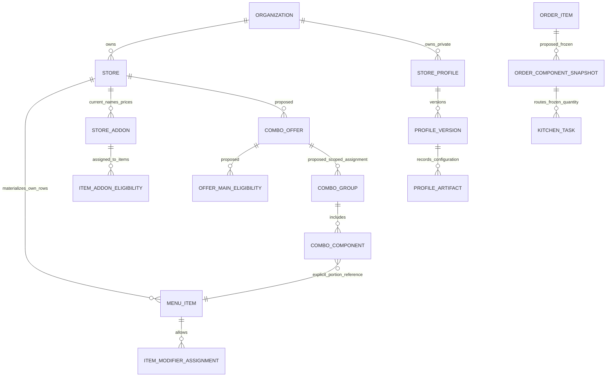

# Allô Nouille 商家配置设计

> 历史规划快照：2026-10-18 Owner Q1–Q9 与已授权本地试点的实际行为，以 [IMPLEMENTATION_RECORD](IMPLEMENTATION_RECORD.md) 为准；本文件原有待批准/未决项不再阻断已明确授权范围。

DESIGN ONLY / NOT INSTALLED。依赖[Capability Gap](CURRENT_CAPABILITY_GAP.md)的E01–E18和[既定商业架构](../../COMMERCIAL_ARCHITECTURE.md)。本设计不改变Owner原来的独立商家app+DB、同一Commercial Core决策。

## 推荐边界

1. 保留 `NEUTRAL_RESTAURANT@v1` 空白preset和 `ST_DENIS_CANONICAL_PROFILE@v2` 原版本/指纹/经营行为。
2. 后续经授权，在Allô自己的环境及Organization下，通过现Owner BUSINESS API创建新的Neutral Store，再应用独立配置。不能读取生产菜单来拼Allô，也不复用本轮Demo Store1/2或其数据库。
3. `ALLO_NOUILLE_PROFILE` 是**拟议的私有、版本化商家配置包身份**，复用现有 `store_profiles` / `store_profile_versions` / `store_profile_artifacts` / aggregate fingerprint。不建另一套Profile registry、菜单库或运行分支。
4. profile root拟为PRIVATE，owner_organization_id必须是实际受授权Allô Organization；当前值UNKNOWN，不填1、不写SQL、不先建公开root。发布前只存在文档中。
5. Allô特色是数据：32可售商品、15加购、2套餐定义、面型与C5规则、份量、标签与经确认的路由。Core只认识通用规则/身份，不认识Allô SKU或品牌名。

现有Profile框架能保存版本/artifact、验证私有引用，不代表当前非Neutral materializer能无改动安装任意餐厅。E18显示其仍有Master/legacy契约。优先Neutral创建后应用配置，避免把Allô塞进兰州clone或伪造Master引用。通用apply/import属于P6依赖。

## 当前字段与未来设计字段严格分开

| 域 | 已有，后续可复用 | 本设计新增概念，当前不存在 |
| --- | --- | --- |
| 身份/权限 | Organization、Store、Owner memberships、StoreAccessService、PRIVATE Profile根权限 | 仅Allô私有配置包内容；不新建租户系统 |
| 元数据 | 当前四字段merchant PUT可写brand_name/locale，含schema/revision；菜单引用只读 | 不能向此PUT加入规则、Profile、语言字典或税覆盖。新增能力在其真实所属资源API扩展 |
| 菜单 | Store-owned category/item/option、canonical Add-on、item eligibility、combo group/component | generic selection constraints、offer/main关联、component-only portion、可售visibility、name_fr等，均待对应PR |
| 价格 | 单品base_price、Add-on当前Store价、单一store_pricing_policy、BigDecimal服务端 | 每offer固定总价/独立eligible set、可信报价revision、前端定点金额；不另起Allô价格engine |
| 履约 | 单品station_id、KitchenTask、打印角色/assignment/Display Rules、冻结print job | 配置化fulfillment、所有included component的任务/BOM数量和语言快照 |
| 导入 | StoreProfile/version/artifact、Owner授权、既有事务/请求协调设施 | manifest validator/diff/dryrun/apply-to-existing-Store接口及操作幂等记录；当前无此API |

不能把拟议字段当现schema，也不在本轮更改Migration。未来新SQL仅additive，版本号在实际PR合并/迁移协调时分配，不预占V41或修改已应用V1–V40。

## 唯一经营来源和关系

图中`proposed`关系以及Modifier assignment/Order component snapshot不是当前已完成表；名字是逻辑设计占位。实现应扩展当前模型，必要时以小型关系表承载真实关联，不能照图机械另造整套菜单。现 `store_combo_groups/components` 继续拥有组件内容；offer表只保存套餐报价和组/主品适用关系，不复制组/商品/价格。

| 事实 | 唯一Source of Truth | Profile/导入职责 |
| --- | --- | --- |
| 可售商品/单点价/所属station | 现Store Menu Management | 发布包保存版本输入，apply后每Store独立；运行不回读包覆盖Store |
| Add-on身份 | Org canonical definition.code | 同语义才复用；不同工艺或份量独立code |
| 当前Add-on名称/价格/active | 现Store Add-on | 不能在option、POS、renderer再维护第二价 |
| 适用商品 | 现Item Add-on eligibility | 以明确B/C item集合展开，不在前端按分类名推断 |
| Modifier约束 | 拟generic group/assignment | 共享required/min/max/default/quantity语义，服务端权威 |
| 套餐价格/资格 | 拟offer+main IDs+有效revision | fixed_total=1999 CAD minor units，两个offer分别定义 |
| 套餐内容/份量 | 现combo内容模型的受控扩展+明确Store Menu Item portion | 同菜不同份量不因名称相近合并；不以独立字符串当履约 |
| Where / How to print | 现station/assignment 与 Display Rules分别负责 | 角色、品牌、显示语言只引用配置，不能定义可售菜单或成交价 |
| 历史内容 | Order/option/component/task/job snapshots | 无菜单更新回写；实际重印沿原job载荷 |

## 拟配置包契约（不是可执行JSON/API）

| 字段/section | 拟值 / 约束 |
| --- | --- |
| profile identity | ALLO_NOUILLE_PROFILE，draft版本由批准时分配，PRIVATE |
| base preset | NEUTRAL_RESTAURANT@v1；不是从Lanzhou派生 |
| source evidence | PDF SHA48df9e…82e130、页码、Owner决议ID、尚未确认项清单 |
| scope | 目标deployment / exact Organization / exact Store，当前均UNASSIGNED；解析同Store codes，不携带原数据库ID |
| categories / sellable_items | A/B/C/E/F五类、32品，全部三语原始文案与价格，见MENU_PDF_ANALYSIS |
| component-only item | 1条素春卷的受控规格；不可单点，不等于A2两条份量。此visibility尚需Core扩展 |
| addon definitions/assignments | 15身份，Store价、active、B/C资格；free次数政策待确认 |
| modifier groups | 面型1选1的建议、C5恰好2、free extra计数；默认/重复未知项显式UNRESOLVED |
| combo offers | NOODLE_1999、RICE_1999；不是全Store combo_delta覆盖 |
| translations | 原FR/EN/ZH逐字值与审校状态，不能用机器填充掩盖缺译 |
| fulfillment / printing | MOCK或DISABLED、无真实endpoint；实际station/纸张语言必须获商家确认 |
| references / fingerprints | code/version/schema/content/artifact aggregate；保持现指纹算法，不改旧Profile版本 |
| forbidden | JWT/secret/credentials、真实用户/订单/顾客信息、LAN IP、支付/OAuth、源Store surrogate IDs、任意脚本 |

`configuration_source`等诊断不是给店主的新步骤。最终店主只应创建/保存一次，系统在授权的导入事务中解析引用、校验版本和生成Store-owned rows；后台复杂度不变成一堆provisioning按钮。

## 安装、变更与权限

未来批准后的最短路径：Owner验证目标Organization → 现Neutral Store创建 → 私有包dryrun → Owner审差异 → 受控apply到该Store → 本地MOCK验收。dryrun/apply目前是**拟新增能力**，不是给现接口换名字。

安装应复用现Profile版本/制品、Store授权、锁/refresh、menu revision和审计。不要把已完成的Store创建ledger改成“再次创建”来安装新包；初始Neutral创建provenance保持真实。AN-PR6须确认已有请求协调器能复用的边界，只补一个target/hash/revision/idempotency的apply操作记录或对原设施的有界扩展，不建立第二Profile系统。原create/replay约束不能为apply而放宽。

运行时仍用现Store实体/菜单/配置reader。当前safe_summary的profile_code不是可写安装入口；不能通过metadata PUT切成Allô，更不能把Allô识别成Lanzhou兼容。需要记录已应用私有制品时，由受审P6安装路径保存明确artifact/version/audit引用；其schema在对应PR中评审，不伪装当前已支持。

导入权限需检查actor active Owner、exact target Store/Org、Profile owner、每个关联实体和锁后再次授权。跨Org clone/import/private版本/artifact直接访问都拒绝；无主owner或无法证明归属时失败关闭。一个Owner可管理两Org也不能把某Org的私有包自动用于另Org。未来跨商家复制需独立明确授权，不能因同一操作员就默认许可。

## 版本与恢复

- 对已有Store应用包不是覆盖全部菜单：dryrun列create/update/unchanged/conflict，保留手工Store override；不按显示名去重、不删遗漏项。
- 规则/价格/翻译/份量/route改变必须纳入menu revision/content hash和必要payload schema版本。复用DB5和原outbox；旧schema payload仍有明确兼容adapter。
- dryrun到apply间revision漂移409；同key同hash返回相同结果，同key异hash409；失败不留下半个menu/config graph。
- 经营更新只影响新订单；旧订单、task、PrintJob payload、claim/lease、未知打印结果与stable retry key不变。
- 错配置用前向修复或发布上一个合法制品内容为新revision；不降DB4、不清draft/outbox、不改已应用Migration、不用旧dump覆盖后来订单。
- 本轮不执行以上流程，不改当前Demo、兰州或Neutral。完整Allô安装依赖P4/P5/P6和具体Owner授权；计划通过不自动打开任何Gate。
