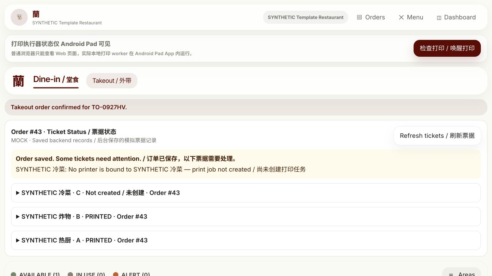
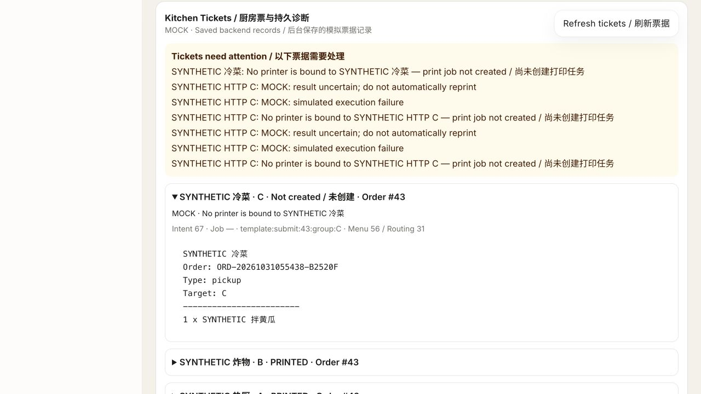

# Phase 6 M0 + M1 — Test Release Evidence

记录日期：2026-10-31 UTC。状态：**Test 技术验收完成；Owner 验收待执行；9项 IMPLEMENTED_AND_TESTED、2项 PARTIAL**。本文件为实际事件证据，不授权下一阶段、合并、旧店迁移或 Production/Staging 发布。

## A. Test 访问和版本身份

- 入口：[https://test.lanzhounoodlesmtl.com](https://test.lanzhounoodlesmtl.com)。DNS A170.106.13.34；预检无AAAA/CNAME。HTTP308跳转同域HTTPS；正常证书链/主机名校验，无 insecure/TLS 降级。
- 最终应用 SHA：`dbe207a1cc62256c7173108ccc375499f1e16caf`；固定源码基线：`028d4971740889a0ac0d784a43497bc3e5b54b3d`。研究目录、GitHub当前main和本地开发HEAD均不充当部署身份。
- 06:07:31 UTC 最终 `/test-health`200、`/login`200、`/api/v1/system/health`200/UP、`/test-code-sha`精确dbe207a。错误Host/SNI两个负例421；`/ws`403。健康检查不等于物理打印验收。
- TLS issuer Let's Encrypt YR1，Test CN/SAN；有效期2026-10-31 04:32:55至2027-01-29 04:32:54 GMT；证书SHA256 `e66fe9cec9b98ff33b7b10ef98b52f0bd363fb6c55323765b5b57fe156cbcc80`。证书续期责任/实际演练 UNKNOWN，未重签旧域名证书。
- Owner/Manager 新Test账号通过本地受保护文件 `.template-test-private/TEST_ACCOUNTS.json` 交付（0600，父目录0700，Git忽略）。仅含Test应用账号，不含DB/JWT；不在公开文档、最终报告或PR打印值。原有生产账号/设备密钥未复用。
- 分支 `codex/template-m0-m1-test-20261031`；[Draft PR304](https://github.com/Z1linXu/Restaurant_System/pull/304) 未合并。当前main观察值80e888fcdad74e98326fcbeaa5df14bc0d9baed6，与固定基线有差异；PR存在冲突，不擅自合并main/rebase。最终文档提交与部署应用SHA分开，文档不会触发重建/部署。

| Artifact | SHA256 / exact identity |
|---|---|
| Running Backend JAR `/app/app.jar` | `77b2204e05af8a828810fed3f42590f432ddeb47a7e70e1239945cb7b41d1362`，实际Test容器内sha256sum |
| Frontend dist tree | `c3e67265f157f231f995a42fce9295ff14c62982dc1d476f1f2a8c75161aa3c6` |
| Release bundle | `f3e2f35b406b9077febd5fc16d992f93debd4218153d903498a6ccc458a911ab` |
| Backend image ID | `sha256:be8f204598522a587632c57c201b3f8f20cf1b8a8504fb5ede5307ab671d546c` |
| Frontend image ID | `sha256:d29338dca8b1777ff6c1fc20b88ffb21ad079574851096d1ffeaeee5e63078a5` |
| PostgreSQL image ID | `sha256:cbf42f0edc946c0bc1b8eeed62403734e1f25dc67a3491455d07a92fdb558b28` |
| Relay image ID | `sha256:84ed8c0dd296c188bfc24ed506f46589e9285fb0b11cf3a04d91d524d3067e11` |
| Final Compose bytes | `531929a81942ac646d64add7e45f4d513f3d2fe208e71b30c18b41292ddd5e17` |

本地构建应用镜像没有registry RepoDigest，故报告实际image ID，不虚构仓库摘要。基础镜像固定来源见 `deployment/test/images.json`。服务端仅COPY已验证产物，不运行Maven/npm构建。

## B. 功能状态

| 功能 | 状态 | 已验证行为 / 具体边界 |
|---|---|---|
| 动态菜单组件库 | IMPLEMENTED_AND_TESTED | Owner/Manager库读写；预设/自定义配置；普通价格使用原item option叶子 |
| 自定义组选项 | IMPLEMENTED_AND_TESTED | 任意组名/稳定code；单选、多选、必选、默认、启停；新厨房票保留制作指令 |
| 组与组内排序 | IMPLEMENTED_AND_TESTED | 持久化两级排序，复查及POS显示测试 |
| 无组Quick Add | IMPLEMENTED_AND_TESTED | public网页新建item14，显式无组，直接入车且无定制弹窗；必选不能绕过 |
| Combo复用 | PARTIAL | 复用旧policy/components/虚拟身份；已验默认、modifier-only egg、legacy COLD linked side及child Remove；未支持的一般LINKED_MENU_ITEM/NO_TASK/HOT side在新adapter明确拒绝，不伪造Task归属 |
| 厨房票组自由配置 | IMPLEMENTED_AND_TESTED | 一/三/更多组、排序、启停、分类、单品覆盖、多组共用MOCK设备；纯预览不写Order/Outbox/Job |
| 多票真实Backend MOCK | IMPLEMENTED_AND_TESTED | 原Order事务→原Outbox→独立adapter→原PrintJobService；稳定source key、顺序/并发幂等和四Job去重 |
| 完整前台小票 | PARTIAL | 首次全部商品、金额/税、Update增量/快照/旧重印路径保留；零价任意CUSTOM detail被受保护旧Renderer过滤，未宣称完整支持 |
| Update增量票 | IMPLEMENTED_AND_TESTED | 只新增batch，原厨房行不重打；同batch重放不增Job |
| 缺打印机Warning | IMPLEMENTED_AND_TESTED | 合法订单保存，A/B继续，C为UNRESOLVED无Job，不假报PRINTED |
| Print Center持久诊断 | IMPLEMENTED_AND_TESTED | 逐Order/batch/group查询冻结文本、意图/Job、状态/原因；实际整页刷新及退出重登保持 |

正常UI库→item为独立副本，A修改不改B/库。未暴露的raw `source_option_id` 导入canonical Remove可保留master引用，后续StoreRemove改名/排序仍传播，是高级API导入P2边界；不作为普通UI独立复制能力宣传。100组/1000选项、数量1..999是技术输入保护；本版未新增可配置业务数量上限、条件DSL、重量计价或促销系统。

前台限制对应 [CR-RECEIPT-CUSTOM-001](CR_RECEIPT_CUSTOM_DETAIL.md)：**PROPOSED / NOT_AUTHORIZED / NOT_IMPLEMENTED**。没有改Renderer，也没有将制作指令塞notes伪装支持。

## C. 代码、API、Schema与保护边界

[完整Git变更清单](RELEASE_CHANGE_INVENTORY.md)：基线→应用提交91路径（55新增、36修改、0删除），Backend45/Frontend24/deployment11，其余文档/忽略规则。最终证据提交仅文档/治理/合成截图。

API统一前缀 `/api/v1/stores/{storeId}/template`，复用既有认证/Store能力/模块门禁：

| Method | Suffix | 行为 |
|---|---|---|
| GET / PUT | `/option-library` | Store库查询/保存 |
| GET / PUT | `/items/{itemId}/option-groups` | Item独立物化组选项查询/保存 |
| GET / PUT | `/kitchen-routing` | Store路由查询/保存 |
| GET | `/printers` | 可选逻辑MOCK目标 |
| POST | `/kitchen-routing/preview` | 无副作用票据预览 |
| GET | `/printing-diagnostics?order_id=&batch_id=` | 持久投影，只读 |
| GET | `/runtime-safety` | Test-only已鉴权非秘密policy/build身份 |

7条route pattern、10个method-pair，详细合同见 `doc/API.md`。既有platform overview响应另修复Store/Organization元数据越界；未新增角色/租户模型。

**V40 additive migration**：`menu_items.template_option_groups_enabled`默认false；`menu_item_options.template_group_code/template_default`；新增`template_item_option_groups`、`template_store_configuration`（库/路由JSON及revision）；既有`order_dispatch_outbox.routing_context`。Test空库V1–V40全部40成功，Hibernate validate成功；V1–V39未改，Production/Staging未迁移。

- **CR-MENU-001**：菜单组metadata、独立item option叶子/价格、显式新模式及服务端验真/既有快照。没有第二套价格/Combo引擎；未启用新marker的旧item仍旧路径。
- **CR-PRINT-001**：纯KitchenRoutingPlanner及独立新事件handler；在既有订单事务冻结`TEMPLATE_KITCHEN` Outbox context，MOCK-only调用原JobService。未重构PrintDispatcher内部、去重算法、状态机或PAD协议。
- **CR-DIAG-001**：在原Outbox记录pre-Job意图/原因/冻结内容，提供scope查询和Warning UI；没有第二队列/可执行状态机。
- **P6-SEC-OVERVIEW-001**：真实Test网页/API发现旧overview对Org1 Owner返回Org1/2及Store1/2（当时template rows0）。最小响应过滤复用StoreAccessService，保留ADMIN全局与合法同Org多店；6个序列化/权限测试及4个真实HTTP负例。它是安全Bug，不是客户Profile需求。详见 [安全修复证据](SECURITY_OVERVIEW_SCOPE_FIX.md)。未推定生产暴露或生产已修复。

**保护证明**：[147文件SHA256清单](PROTECTED_BASELINE.sha256)逐项匹配固定028。旧GRAB/HOT/FRONTDESK Renderers、PrintDispatcher内部、PrintJobService/去重/状态、PAD_DIRECT协议、Android及V1–V39均未改变。测试代码新增fixture依赖/手工H2列不改变成熟执行源码。Research36报告+固定HEAD028原样；370排除路径继续排除，未读取dump/密钥作为输入。原开发区没有reset/clean/stash/业务覆盖。

## D. 实际测试与验收

详见 [TEST_COVERAGE_REPORT.md](TEST_COVERAGE_REPORT.md) 的用例/函数映射；统计是执行次数，不能当作100%代码覆盖率。

| Check | 实际结果 | 环境/命令/边界 |
|---|---|---|
| Backend | **1310 total /1193 executed successful /117 conditional skipped /0 failures/errors** | JDK21 `mvn -q verify` exit0；最终dbe运行源；跳过的外部PG条件套件仍NOT_RUN |
| Frontend | **71 files /401 tests PASS**；tsc/Vite build PASS | `npm ci --ignore-scripts`、`npm test`、`npm run build`；401之后UI源未变，最终dbe精确构建；focused eslint0error/1旧warning |
| Local real-JAR HTTP | **45 PASS /0 FAIL** | 真实Spring/独立PG；最终dbe/JAR77b；`python3 backend/test_template_platform_http.py`配受保护Test输入 |
| Public HTTPS HTTP | **45 PASS /0 FAIL** | 05:46:06–05:47:34 UTC，正常TLS验证/拒绝redirect；Owner/Manager、价格/Combo/路由/幂等/Update/失败/Overview越界 |
| Deployment safety | **62 PASS /0 FAIL**；独立Agent6 ACCEPT | `python3 -m unittest discover -s deployment/test -p test_safety.py`；Compose真实config、AST/shell、fakeNginx成功/失败清理等 |
| Remote Test SQL supplement | **19 PASS /0 FAIL** | 05:48:39 UTC，明确Test DB、SELECT-only只读事务；Combo order34/35、Task35–38、唯一Job/frozen text、scope及无真实设备/endpoint/Uber |
| Migration | **40/40 success，V40** | 独立远端Test PG16；实际ledger及validate；本地PG18也通过，不代表两环境所有行为相同 |
| Legacy regression | **PASS within executed automated scope** | 原GRAB/HOT/前台文本/金额/字节、Job/Dispatcher/Pad token/expiry、不确定保护及快照；是1310子集，不能重复相加 |
| Browser public smoke | **PASS in observed slice** | Root真实Owner登录/新item14/QuickAdd/Chicken差价/Order43/Warning/打印中心刷新+退出重登；不代替Owner10步全量验收 |
| Owner acceptance | **OWNER_NOT_RUN** | 等待Owner，不预填通过 |

**实际业务证据**：公网页面提交Order43（三商品），subtotal20.50/total23.57；A/B各有MOCK PRINTED Job，C未绑定→Outbox intent67，source key`template:submit:43:group:C`，UNRESOLVED且无Job；前台Job包含全部三商品。恢复C绑定至原MOCK printer3后，旧intent不被新配置重写。Order21四个旧Job31/30/29/28在实际Test后端更新重启前后ID/状态/retry_count/文本hash不变，不确定结果未自动重发。

实际网页截图（均为合成材料，无凭据）：

**执行与失败透明度**：最初full verify20个fixture/context错误修正必要mock/手工H2列后重跑；没有削弱业务断言。新权限测试ObjectMapper时间模块fixture也修正后重跑。旧HTTP错误oracle要求所有legacy前台Job.execution_mode=MOCK，实际旧路径为NULL；保留原失败receipt，只有Store MOCK、MOCK_RENDERED、无printer/endpoint及SQL补证满足才允许旧NULL，泛化新厨房Job仍严格MOCK。所有旧receipt保留，不改名冒充最终结果。

Test部署遇到tmpfs YAML拆分、仅internal bridge无法publish、重用容器丢db alias及nginx /dev/stdin不兼容，均保留失败日志，只修Test工具/重建自身容器而不删除数据，复审后重试。安全overview P1发现后新增6测试、重新全量verify/精确构建/部署/45HTTP验证。无必要的文档提交不再触发部署。

网页KitchenRules保存的原生确认自动化发生协议超时，后续GET已显示C=null；本次受控解绑/恢复亦通过授权管理REST核对。**未宣称原生确认自动化完整通过**；该限制与实际页面订单提交/重登持久化证据分开。没有绕过CUA拒绝的原生App访问。

## E. Owner 网页验收

使用受保护Test账号，按 [10步验收清单](OWNER_ACCEPTANCE_CHECKLIST.md) 记录结果：登录→创建无组选项炸春卷→炒鸡辣度/Add-on/Remove→自定义面条组→两级排序→A/B独立复制改价→配置A/B/C厨房票→三张MOCK票→前台/Update→C解绑后订单成功、A/B完成、C Warning及刷新/重登诊断。仅合成门店/逻辑MOCK设备。现有预置配置已恢复三个组完整绑定，Print Center保留历史Order43失败供检查。

遇前台零价CUSTOM缺失及不支持Combo side时按上述PARTIAL判断；不要据此给旧Renderer/真实打印/生产迁移补授权。

## F. 安全、环境与UNKNOWN

- Test root `/srv/restaurant-pos/test`；sealed release `releases/dbe207a1cc62256c7173108ccc375499f1e16caf`；独立Compose project `restaurant-template-test`、独立PG库/凭据/volume/两条Test专有bridge。Backend/DB无host port/外网egress；frontend仅127.0.0.1:28080；relay只准已验证旧edge源地址。未加入Production网络。
- 配置来自sealed Compose、固定镜像/只读受限容器及新 `/srv/restaurant-pos/test/private/runtime.env`0600。环境白名单不转存生产秘密；启动前Test datasource/REAL/endpoint/Flyway保护，禁默认/生产seeders、daily-close、Uber/实际支付。打印MOCK-only，无真实endpoint、devices、Uber绑定/外部订单；SQL数量为指定时间观察，不是全部历史无事件的数学证明。
- **Production/Staging应用/数据库未被本任务部署、重启、迁移或写入；三家旧店业务/菜单/价格/设备、Android/APK未改。** 共用物理主机仅共享edge例外：备份/锁/CAS/校验、追加Test vhost、两次安全graceful reload。不是“共享入口绝对未改”。
- 原8容器ID/image/StartedAt/restart_count前后一致；所有running、旧DBhealthy；旧HTTP200及证书指纹未变。旧nginx前5595字节hash `b9d6c2618d96b1c0710df4a6346c63ec06b23770f4dde0724adaa6272e27b2e0` 原样；最终追加配置hash `c70c419d83f6d541228a27bdf66bec59d62aca43832f108a0de6cdea07a42db8`。备份 `/srv/restaurant-pos/test/ingress/original.conf`0600。
- 147文件保全证明与旧行为自动化互补；没有冒称真实三店全部菜单/终端行为测试100%完成。未读员工/顾客/真实订单/生产密码；未导入Production交易、无真实打印/Pad配对/无线故障/断电/实体纸张/Uber接单/支付/生产备份恢复测试。
- **F31 STOMP和F47设备凭据风险未关闭**。Test公开`/ws`拒绝、独立凭据及devices0是本环境限制，不是多租户SaaS安全放行。Overview仅修具体响应暴露，不替代全权限面安全审计。Phase0/1剩余UNKNOWN保持，包括Production实际运行来源/APK、恢复可行性和此前未确认事实，不从Test反推。
- 当前frontend依赖审计26项旧问题/既有warning未在本范围升级；锁/依赖未改。无可信全仓覆盖率、性能/负载benchmark、真实弱网/长离线恢复证明。旧rollback历史镜像全集未审计，不能声称所有历史产物绝对不变。
- 本地临时Java/Vite/PG已安全停止，数据/证据保留；远端Test继续运行。没有新工具/plugin/Hook安装。

## Docker / Disk Hygiene

| Observation | Before | After |
|---|---:|---:|
| Root disk used | 79% | 67% |
| Available | 12,553,500 KiB (~11.97GiB) | 19,718,040 KiB (~18.80GiB) |
| Build cache | 16.82GB /291 records | 8.293GB /209 records |
| Reclaimable cache | 10.45GB | 1.576GB |
| Images | 8.301GB /123 | 9.399GB /134 |
| Containers | 8 | 12 (新增4个Test) |

本任务**未执行prune、手工缓存清理、image/volume删除或release目录删除**。观察到cache下降约8.53GB，原因 **UNKNOWN / unattributed**（未验证是否daemon GC/并行维护），不能归因本任务回收。所有旧运行容器/DB/当前镜像受保护证据通过；Test数据volume保留。缓存8.293GB处于8–12GB观察区间，不继续无授权清理。

## Execution Time Breakdown

任务开始 **2026-10-31 04:23:30 UTC**；最终Stop时间在Owner最终回复记录。下表stage为Estimated，有并行重叠，不能简单求和；Total使用实际开始到最终Stop。

| Stage | Time | Notes |
|---|---:|---|
| Investigation / Planning | Estimated8min | 固定基线、授权/网络/资源、保护清单 |
| Implementation | Estimated35min | 菜单/路由/事务/诊断/UI及最小安全修复；不含未授权核心改造 |
| Tests | Estimated30min | focused/full verify、401、真实HTTP/SQL及fixture重试；与实施/部署交叠 |
| Agent6 / PR / Merge | Estimated15min | 产品/部署交叉独立复审、合并阻塞修复后再审；Draft PR；Merge N/A |
| Staging Deploy | N/A | 未授权/未执行 |
| Staging Acceptance | N/A | 仅只读安全观察，未做本版Staging验收 |
| Test Deploy | Estimated35min | 新环境、TLS、4个部署兼容问题及最终P1安全候选重新发布；旧DB保留 |
| Test Acceptance | Estimated25min | TLS/45HTTP/19SQL、网页真实Order43及刷新重登 |
| Evidence / Governance | Estimated20min | 文档、证据hash、保全核对、最终PR同步 |

主要耗时来自新Test拓扑兼容修复、独立Agent6复审、安全P1发现后的全回归和重新发布；未以文档完成代替运行验收。

## Evidence index

公开文档只引用无秘密元信息。原始receipt/日志由本地0700 ignored目录保管，以下路径均相对worktree；账户文件不进入索引hash或公开内容。具体时间/环境仅由对应证据支持。

| ID | Receipt / source | SHA256 |
|---|---|---|
| E-BE | `.template-test-private/candidate-unit-proof-dbe207a.json` | `4e16253161091005c3c89fb2f82e81aab75678a07959d59bc6885ae8f31349ad` |
| E-LOCAL | `.template-test-private/http-local-dbe207a.json` | `e0a37cdab9236aff81caf5d861f482a5ae3491c7e4cc6592cfad8aed7d716379` |
| E-PUBLIC | `.template-test-private/http-public-dbe207a-final.json` | `59cf0d3a6f0c1042a46f64965857066a3c4b3da551fcafc02cbb5f773df2f4b5` |
| E-SQL | `.template-test-private/sql-public-dbe207a-final-proof.json` | `42108d64dec84eb498c095fad09a98708c66db353546752fe8dfe66305707bc5` |
| E-BROWSER | `.template-test-private/public-browser-acceptance.json` | `51e1b4aad5d71063b03cc4a1a20d2ed27d25cbff12438c01dedd0903fb533239` |
| E-TLS | `.template-test-private/public-final-health.json` | `888ef1e1476ec575332faf9d52e50915ee7dcce9b2bf09211abf27cf5b44c631` |
| E-HOST-BEFORE | `.template-test-private/remote-before.json` | `355b016f86e01ee383a31f8197f72da421b46dfcaffe3cb63ea6393dc49d4f19` |
| E-HOST-AFTER | `.template-test-private/remote-final-state.json` | `1383d716f8cf7a9e251718cd5d1b92725f9a1e59bf08c5d9022904fcb2cad23a` |
| E-RUNTIME | `.template-test-private/actual-remote-candidate-dbe207a.json` | `1c04a9f8f0c30666e9a5d71510f9ae9c8e3298ed65fdf8d3d6997888650c7664` |
| E-RESTART | `.template-test-private/security-and-restart-after.json` | `ab96173c1b75bb00bcba6320148e66bc168f73cf1da91857c42102e130221fde` |
| E-RESEARCH | `.template-test-private/research-preservation-proof.json` | `b4789a5ef591987a997cd95822d1a3007aa51c1c71761ba17efc4b1b99868690` |
| E-LOCAL-STOP | `.template-test-private/local-test-shutdown.json` | `d2d451b7c4a720ac2948a0422361bd85f6e7bf5b409859f11f464b747b68c049` |

另存原始backend verify日志/exit、Frontend最终build日志、remote-deploy日志/40行ledger、HTTP/HTTPS ingress先前失败与成功log、Certbot签发log及旧域名before/after。独立Agent6评审、401 Vitest输出保留于会话；未捏造额外JSON或行覆盖率。公开截图是Root观察证据，Owner仍应独立验收。

治理validator在固定源sparse排除路径，本次只读Git读取并以内存执行原脚本，实际结果 `EXPECTED_FAIL: repository.ref must be origin/main`，与Owner指定固定基线feature branch不一致；未修改script/伪造ref。复用原mapping parser另核对单一Phase/Owner Gate、禁Prod/Stg/受保护核心/下一阶段及精确Test SHA，并检查本阶段全部Markdown链接：`PHASE6_MAPPING_AND_NEW_LINKS|PASS`。完整validator不标PASS。其后状态更新不是新实施授权。

**STOP：等待Owner审阅M0/M1及PARTIAL边界；不自动merge、开M2/下一阶段、实施CR或部署旧环境。**
